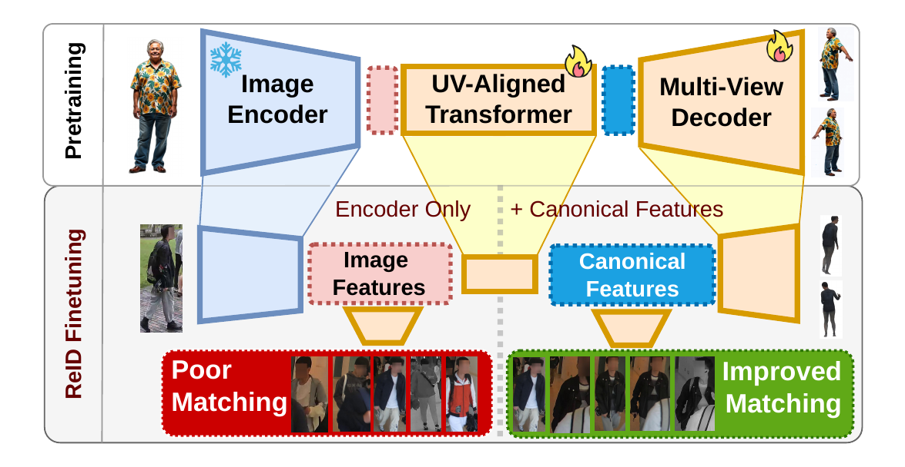
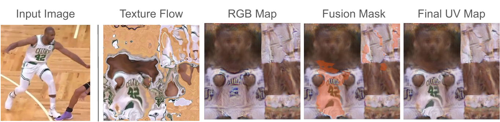

# UV-ReID: Canonical Texture Pretraining for Robust Person Re-Identification

**Official repository** for the paper *"UV-ReID: Canonical Texture Pretraining for Robust Person Re-Identification"*, published at **WACV 2027 (Algorithms Track)**.

Karol Wojtulewicz\*, Minxing Liu\*, Josef Bengtson, Niklas Carlsson

Link&ouml;ping University, Sweden &nbsp;·&nbsp; Chalmers University of Technology, Sweden

\* Equal contribution

  

UV-ReID uses human UV texture reconstruction as label-free pretraining for person re-identification. A lightweight UV-aligned transformer is trained on frozen DINOv2 features with synthetic multi-view humans. It learns to map generic image features into pose-normalized descriptors aligned with the body surface. At inference, the texture decoder is discarded and only the input image is needed. No SMPL fitting, pose estimation or body-part inputs are required. UV-ReID trains only an 11M-parameter module on top of frozen DINOv2. It is competitive with specialized methods across cloth-changing, video, sports and UAV/cross-platform ReID benchmarks, and reaches state-of-the-art results in several settings.

## Architecture

UV-ReID has four parts: a frozen DINOv2 image encoder (Base or Large), a lightweight UV-aligned transformer neck, a UV decoder for texture supervision, and a ReID head. Multi-scale DINOv2 features are projected into a shared space. The UV-aligned transformer then maps them onto a 32×32 canonical grid that follows the UV parameterization of the human body. Training has two stages:

1. **Canonical texture pretraining.** The transformer is pretrained on HuGe100K with multi-view texture reconstruction. Each predicted UV texture is rendered and supervised from several viewpoints.
2. **ReID fine-tuning.** Standard identity losses are combined with multi-view texture objectives that keep the canonical structure. A text-conditioned Multi-Space Multi-View loss extends this to multimodal and cross-domain settings.

  

During training, the UV decoder predicts three outputs. A texture flow samples detailed visible regions from the input image. An RGB map captures global appearance. A fusion mask combines the two into the final UV map. The decoder is used only for supervision and is removed at inference.

## Code and Models

The full code, including training, evaluation and pretrained models, will be released here **by December 2026 at the latest**. Star or watch this repository to get notified.

## Citation

Citation details will be added when the proceedings are available.

## License

This project is released under the [MIT License](LICENSE).
